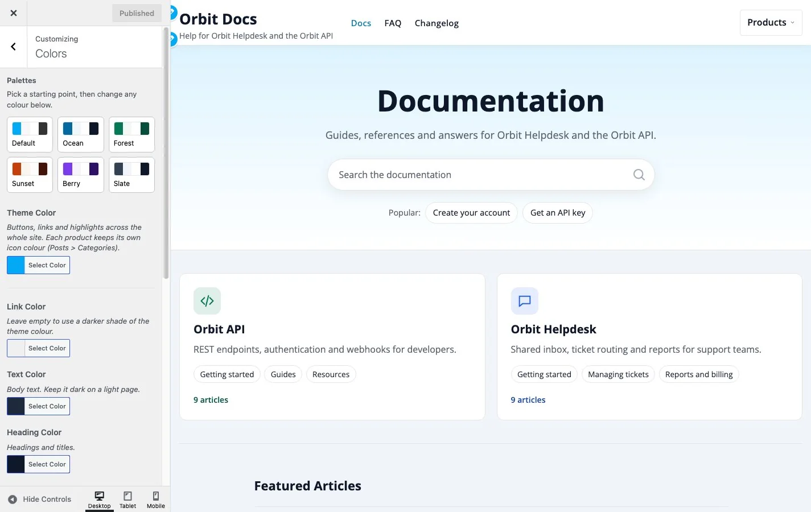
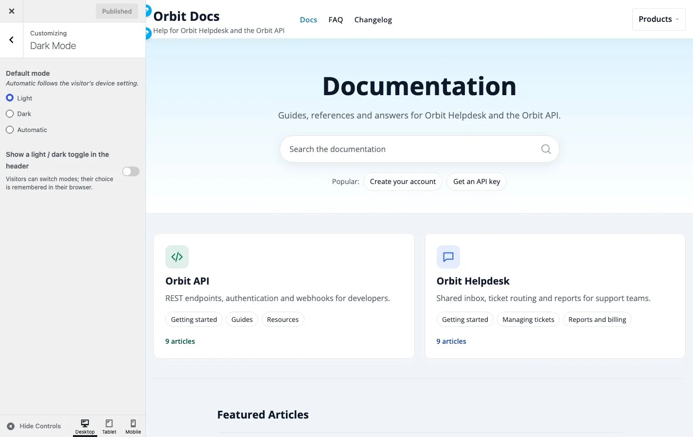
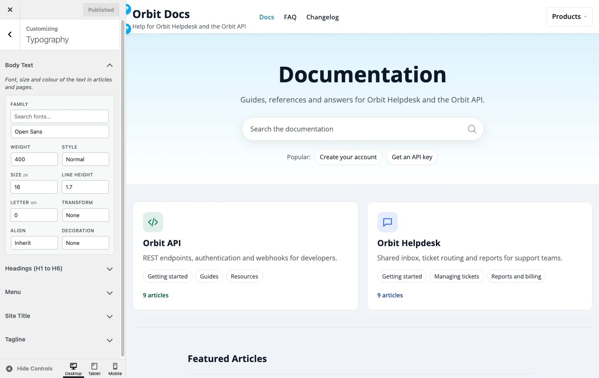
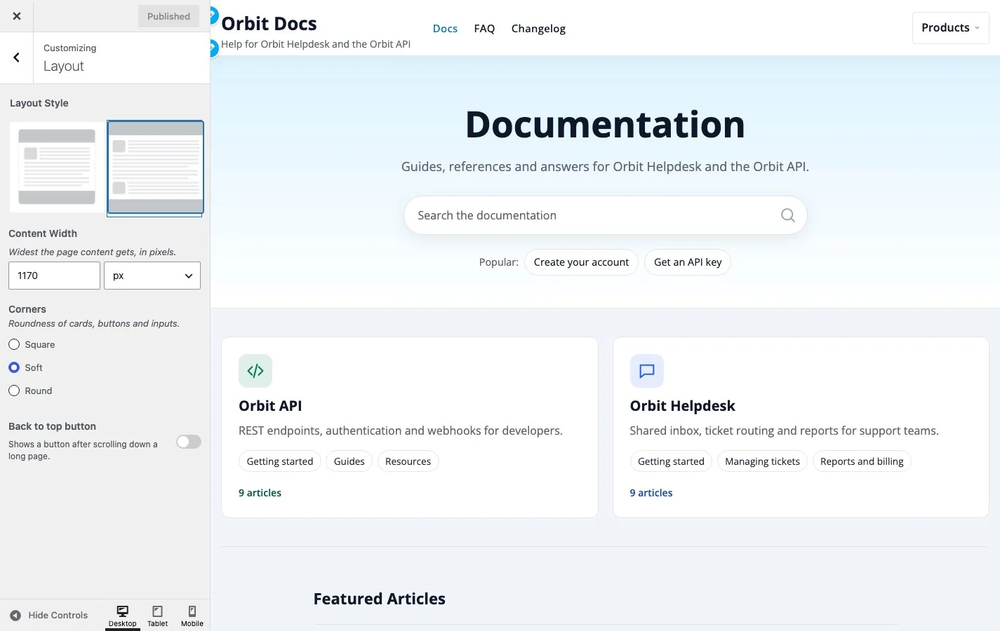
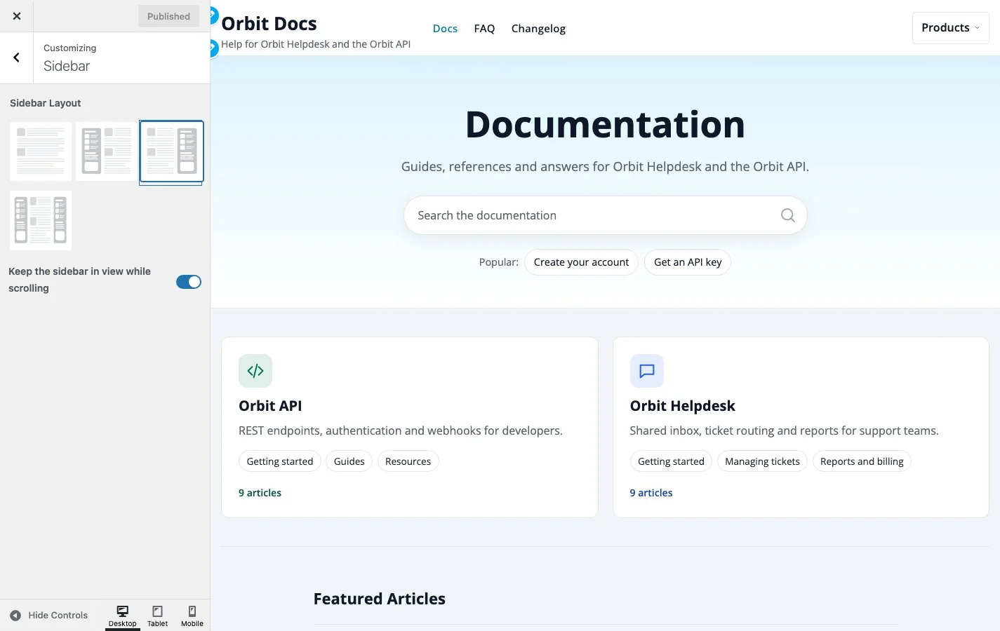
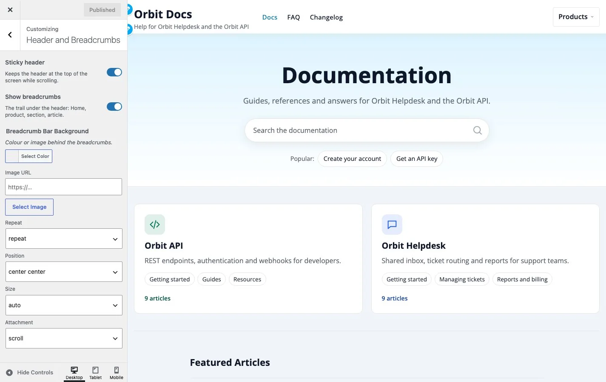
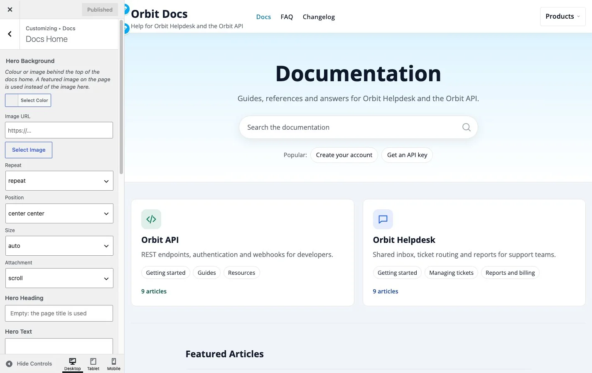
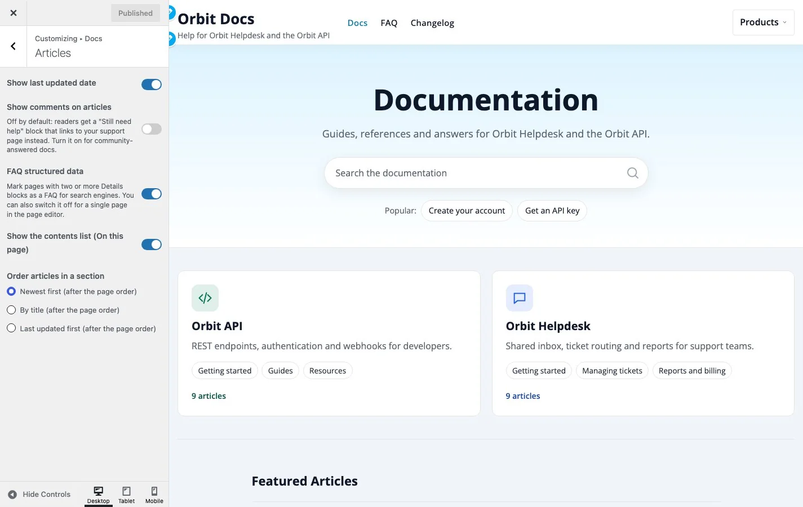
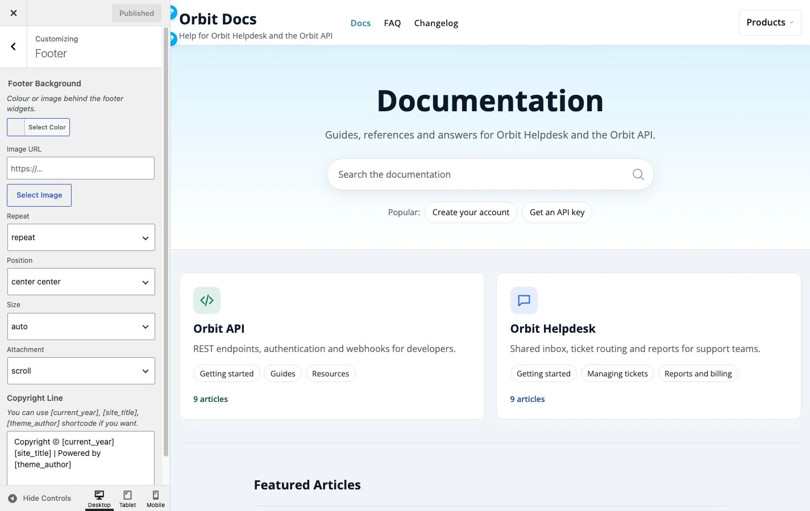

# Customizer step by step

**Included in Free**

A guided tour of **Appearance > Customize**, in the order most sites set things up. Each step names the panel, what to change and what to expect. Changes preview live on the right; nothing goes public until you press **Publish**.

To open a panel directly, use the list on the left of the Customizer. A panel with a back arrow at the top returns you to the list.

## Before you start

1. Create your product, sections and a few articles first, so the preview shows real content. See [Set up docs for one product](../getting-started/06-single-product-kb.md) or [Set up docs for several products](../getting-started/07-multi-product-kb.md).
2. Open **Appearance > Customize** from the admin menu, or click **Customize** in the admin bar on any page to preview that page.
3. Use the **Desktop / Tablet / Mobile** buttons at the bottom to check each size before you publish.

## Step 1. Site Identity (WordPress panel)

Upload your **Logo** and **Site Icon**, and set the **Site Title** and **Tagline**. The tagline is shown under the title in the header. If you upload no logo, the title is used.

## Step 2. Colors

Open **Colors**. Start with a palette, then adjust.

1. Pick a **palette** (Ocean, Forest, Sunset, Berry or Slate) as a starting point. **Default** returns every colour to the theme's own.
2. Set **Theme Color** to your brand colour. Buttons, highlights and links follow it.
3. Leave **Link Color** empty to get a darker shade of the theme colour that stays readable.
4. Check **Text Color** and **Heading Color** against **Page Background Color**; keep text dark on a light page.
5. Set **Header Background** and the footer colours last.

Details: [Colours and dark mode](02-colours-and-dark-mode.md).

## Step 3. Dark Mode

Open **Dark Mode**.

1. Choose the **Default mode**: Light, Dark, or Automatic (follows the visitor's device).
2. Switch on **Show a light / dark toggle in the header** if you want visitors to choose. Their choice is remembered in their browser.

Dark mode has its own palette, so your light-mode text and background colours never produce dark text on a dark page.

## Step 4. Typography

Open **Typography**. Each group opens from its title.

1. **Body Text**: family, size, weight and line height of paragraphs. The defaults (16px, line height 1.7) are tuned for reading.
2. **Headings (H1 to H6)**: change only if your brand needs it.
3. **Menu** and **Site Title and Tagline**: size and weight of the header text.

Details: [Typography](03-typography.md).

## Step 5. Layout and Sidebar

1. **Layout Style**: wide or boxed.
2. **Content Width**: the widest the content gets. The default is 1170px.
3. **Corners**: Square, Soft (default) or Round. One choice changes cards, buttons, inputs and blocks together.
4. **Back to top button**: off by default; turn it on for long articles.

Open **Sidebar** to place a sidebar left, right, both or none. It applies to the posts page and ordinary pages. Product articles use the docs layout with the section tree, so they have no sidebar.

Details: [Layout and sidebar](04-layout-and-sidebar.md).

## Step 6. Header and Breadcrumbs

1. **Sticky header**: keeps the header and search in reach. On by default.
2. **Show breadcrumbs**: the trail Home, product, section, article. Keep it on; it is how readers find their way back.
3. **Breadcrumb Bar Background**: colour or image for the bar.

Assign your menu under **Menus** to the **Primary** location. Details: [Header and breadcrumbs](05-header-and-sub-header.md).

## Step 7. Docs

The **Docs** panel has three sections.

**Docs Home** controls the first page readers see.

1. **Hero Background**: colour or image.
2. **Hero Heading** and **Hero Text**: leave empty to use the page title and excerpt.
3. **Products on the docs home**: product cards or each product with its sections (several products only).
4. **Show the recent articles list** and **Show the support block**: switch off what you do not need.
5. **Support Heading, Support Text, Support Button Text and Support Button Link**: the closing block. It appears only when you set a button text and link, or your own text.

**Articles** controls what every article shows.

- **Show last updated date**, **Show the contents list** ("On this page") and **Show comments on articles** (off by default).
- **FAQ structured data** marks pages with two or more Details blocks as a FAQ for search engines.

**Docs Index** sets the number of articles per category and their order on the Docs Index template.

Details: [Docs home settings](07-docs-home-settings.md).

## Step 8. Footer

1. **Footer Background**: colour or image behind the footer widgets.
2. **Copyright Line**: free text with the placeholders `[current_year]`, `[site_title]` and `[theme_author]`.

Add footer widgets under **Appearance > Widgets** and a footer link row by assigning a menu to the **Footer** location. Details: [Footer and copyright](06-footer-and-copyright.md).

## Step 9. Publish and check

1. Press **Publish**.
2. Open the site in a private window and check the docs home, a product page, an article and search.
3. Check a phone: the header shows a menu button, the section tree becomes a panel above the article.

## Recipes

### Match my brand

1. **Site Identity**: upload the logo.
2. **Colors**: set **Theme Color** to the brand colour; leave **Link Color** empty.
3. **Typography > Headings**: set the brand font if you have one added through the WordPress Font Library.
4. **Layout > Corners**: Round for a friendly brand, Square for a formal one.

### Offer a dark mode

1. **Dark Mode**: set the default to Automatic.
2. Switch on the header toggle.
3. Open the site with the toggle on both settings and check the docs home and an article. Light colours you set do not carry into dark mode, so there is nothing to fix twice.

### A quiet, text-first help centre

1. **Colors**: choose the **Slate** palette.
2. **Docs Home**: leave the hero text empty and switch off **Show the recent articles list**.
3. **Articles**: keep **Show the contents list** on, switch off **Show last updated date** if your articles rarely change.
4. **Layout > Corners**: Soft or Square.

### Send readers to a human when the docs do not answer

1. **Docs Home**: set **Support Text**, **Support Button Text** and **Support Button Link** to your contact page.
2. Every article now ends with a "Still need help?" block that uses the same link.
