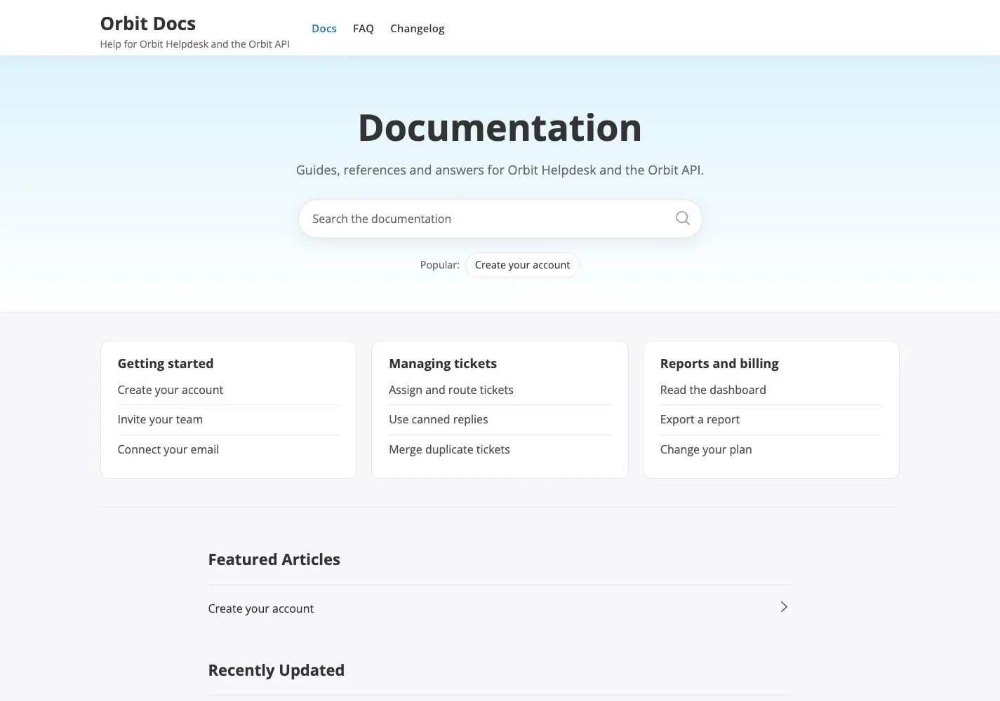
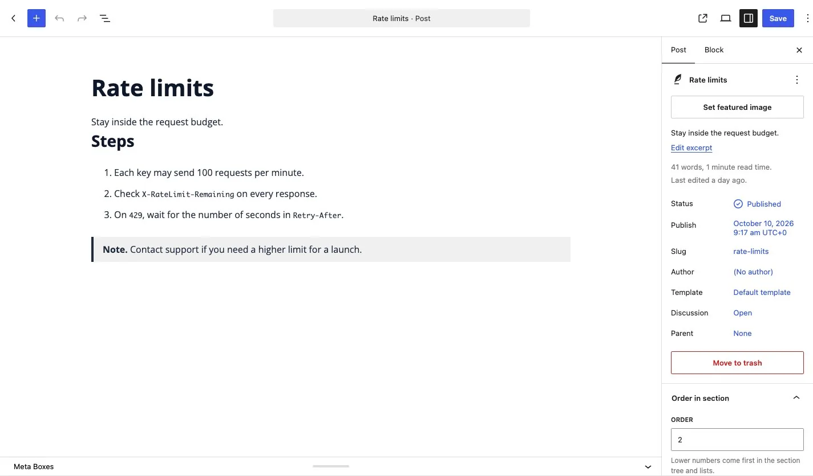
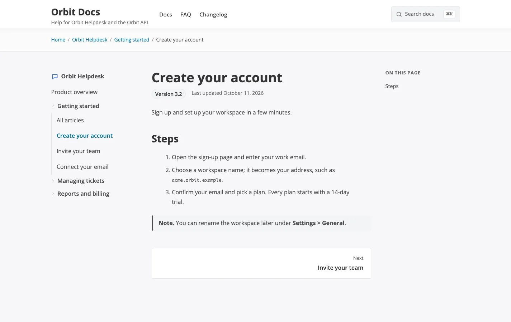

# Set up docs for one product

**Included in Free**

Use this guide when your site documents a single product: one app, one plugin, one API. For a site with several products, read [Set up docs for several products](07-multi-product-kb.md) instead.

Typical uses: the help centre of a SaaS app, the documentation of one plugin or theme, the developer guide of one API.

## What readers get

With one product, KnowX skips the product layer. The docs home lists your sections as cards, each with its first articles, and the header has no **Products** menu because there is nothing to switch between.

## Step by step

### 1. Create the product

1. Go to **Posts > Categories**.
2. Add a category with no parent. Use the name of your product, for example "Orbit Helpdesk".
3. Write a one-line description.
4. Pick an **icon**. Leave **Product accent colour** on Automatic: with one product the theme colour from **Customize > Colors** is used, so the whole site stays one colour.

The product is the top level of your table of contents. Readers see its name in the breadcrumbs and above the section tree, not as a card.

### 2. Add the sections

Add child categories under the product, one for each topic readers look for, for example "Getting started", "Managing tickets", "Reports and billing". Keep it to about three to eight sections. A section can have child sections one level deeper.

### 3. Write the articles

1. Add a post with **Posts > Add New**.
2. Tick one section. Do not tick the product itself; tick the section the article belongs to.
3. In the editor sidebar, set **Order in section**. Lower numbers come first.
4. If the article is true for one version only, fill in **Docs > Applies to version**. It shows as a badge under the title.

An article page shows the section tree on the left, the article in the middle and "On this page" on the right.

### 4. Create the home page

1. Go to **Pages > Add New**, title it "Documentation" and choose the **Docs Home** template. The excerpt is shown in the hero under the title.
2. Go to **Settings > Reading**, choose **A static page** and select the page as your homepage.

### 5. Add the menu

Go to **Appearance > Menus**, create a menu with Docs, FAQ and Changelog and assign it to the **Primary** location. Until you assign one, the theme lists your pages in the header.

### 6. Make it yours

Open **Appearance > Customize**. For a single product these settings matter most:

| Setting | Where | Suggestion |
|---|---|---|
| Theme Color and palette | **Colors** | Match your product's brand colour. |
| Logo | **Site Identity** | Upload it; the site title is used until you do. |
| Hero Heading and Hero Text | **Docs > Docs Home** | A short promise, such as "How can we help?". |
| Support block | **Docs > Docs Home** | Add a button to your contact page so a reader is never left at a dead end. |

See the [Customizer step by step](../customizing/08-customizer-step-by-step.md) for every panel.

## Tips

- **Keep articles short and one task each.** Readers search first; a title that names the task ("Merge duplicate tickets") wins over a vague one.
- **Use the Start here link.** On the category screen, set **Start here link** to your onboarding article so the product page's button goes where new users should begin.
- **Add products later without rework.** If you later add a second product, the cards, the **Products** menu and the search filter appear on their own and your articles keep their sections.
