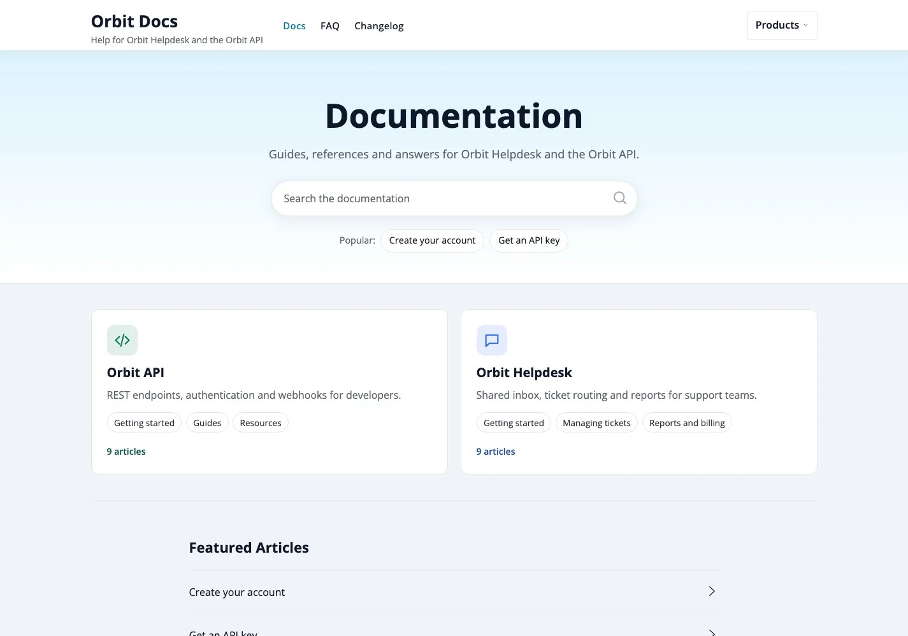
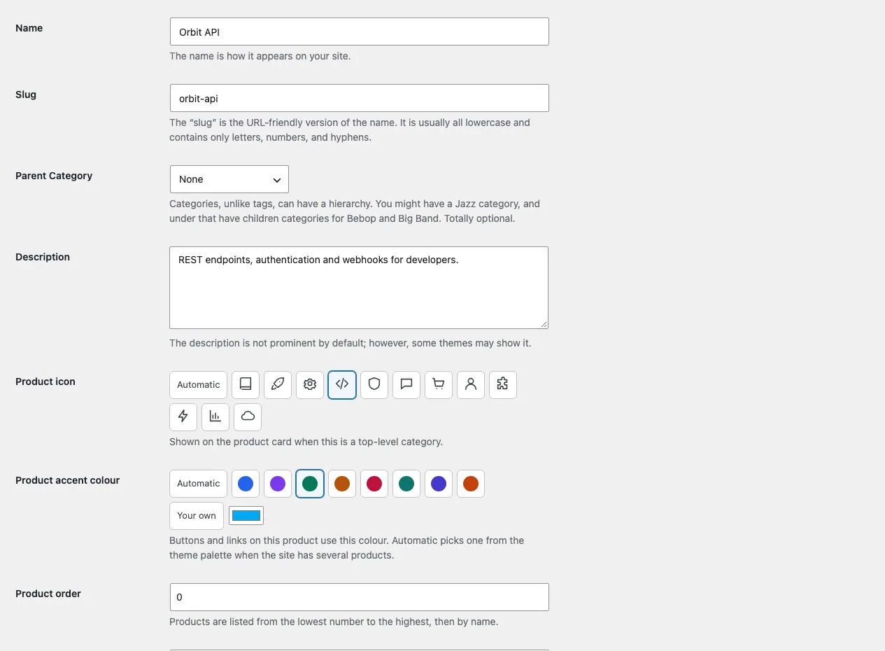
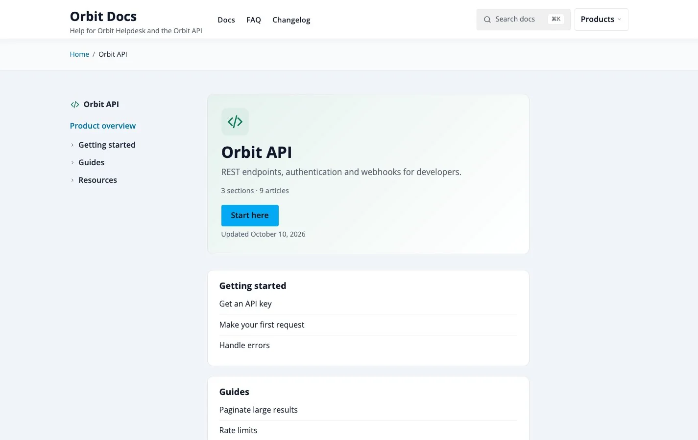
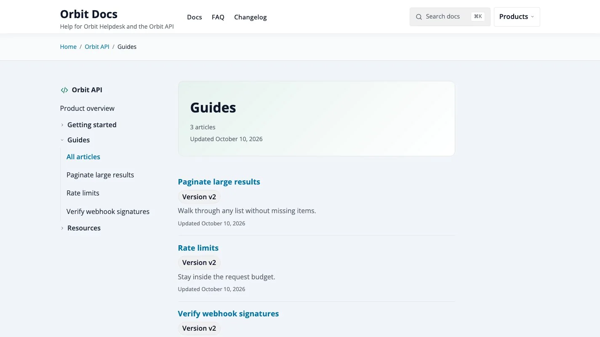
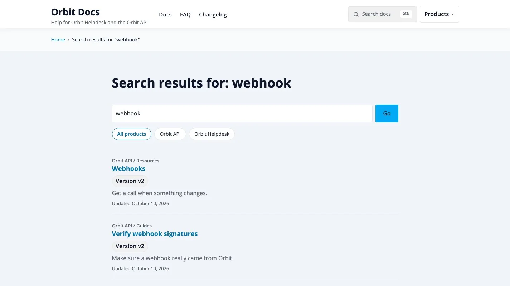

# Set up docs for several products

**Included in Free**

Use this guide when one site documents two or more products: an app and its API, a plugin family, a product and its add-ons. For one product, read [Set up docs for one product](06-single-product-kb.md).

Typical uses: a company help centre with a web app and a developer API, a plugin shop with a documentation site per plugin, a software suite with separate manuals.

## What readers get

With two or more products the docs home shows one card for each product, with its icon, description, sections and article count. The header gets a **Products** menu, and search results can be limited to one product.

Each product also has its own look. With no choice made, KnowX gives every product an icon and an accent colour from its palette, so the cards differ out of the box. You can pick your own.

## Step by step

### 1. Create one category for each product

1. Go to **Posts > Categories**.
2. Add a category with no parent for every product, for example "Orbit API" and "Orbit Helpdesk".
3. Write a one-line description. It is shown on the product card.
4. Choose an **icon** and, if you want, a **Product accent colour**: Automatic, one of the swatches, or your own colour. The colour is used on that product's card, icon and page header.
5. Set **Product order** if you want a fixed order. Lowest number first, then by name. It applies to the docs home, the **Products** menu and the search filter.

WordPress' own "Uncategorized" category is never shown as a product.

### 2. Add sections under each product

Add child categories under each product. Use similar names across products if the products are similar ("Getting started", "Guides"); readers will find their way faster. Sections of different products can share a name, because search results and archives show the product and section above each title.

### 3. Write the articles

1. Add a post and tick the section it belongs to, in the right product.
2. Set **Order in section** in the editor sidebar.
3. If the article only applies to one version, fill in **Docs > Applies to version**.

An article never belongs to two products. If two products share a step, write it once and link to it from the other.

### 4. Check the product pages

Open a product from the home page. A product page lists every section with its first five articles and a link to all of them.

A section page lists the articles of one section with a short excerpt and a page number list.

Set **Start here link** on the category screen if the **Start here** button should open a specific article. Empty opens the first article.

### 5. Create the home page and menu

1. Create a page with the **Docs Home** template and set it as your homepage under **Settings > Reading**.
2. Create a menu with Docs, FAQ and Changelog under **Appearance > Menus** and assign it to **Primary**. The **Products** menu is added automatically.

### 6. Check search

Search results show **All products** and one button for each product. Choosing a product limits the results to it and its sections.

## Choose how the home page lists products

Go to **Appearance > Customize > Docs > Docs Home** and open **Products on the docs home**:

| Choice | Best when |
|---|---|
| Product cards (default) | You have a few products and want readers to choose one first. |
| Each product with its sections | You have two or three products and want readers to see the sections without another click. |

If you have many products, use **Hide Categories** in the same panel to keep retired or internal products off the home page. Enter the category IDs separated by commas; their sub-categories are hidden too.

## Tips

- **One colour per product, one theme colour.** Buttons and links follow the theme colour on every page; the product colour marks the card, the icon and the page header. This keeps the site one brand while the products stay easy to tell apart.
- **Order by importance, not by name.** Give your main product `0` and the others `10`, `20` so you can slot a new one in later.
- **Name versions in the article, not the category.** Use the version badge so one product keeps one tree. See [Products, sections and articles](../features/01-products-and-sections.md).
- **Large sites.** Product lists are cached and refresh when you publish or edit. See the same page for the limits.
